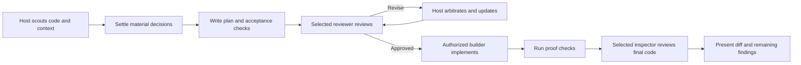

<div align="center">


### Composable planning and review across agents.

[](https://github.com/chaseai-yt/claudex-loop/stargazers)
[](./LICENSE)
</div>

This repository separates plan authoring, agent review, task routing, and the complete development workflow. Choose agents by role instead of installing a skill for each pair. They share a repository and plugin distribution; **Claudex Route is independent of the Claudex Loop workflow**.

| Skill | Use it for | Dependencies |
|---|---|---|
| [`claudex-route`](skills/claudex-route/SKILL.md) | A model recommendation or one scoped handoff | Self-contained; selected CLI needed only for delegation |
| [`claudex-plan`](skills/claudex-plan/SKILL.md) | Requirements and plan authoring, without launching review or implementation | Shared `claudex-loop` references; no CLI for planning alone |
| [`claudex-review`](skills/claudex-review/SKILL.md) | Review an existing plan or code changes with the selected agent | Shared runner, Python 3.10+, selected CLI |
| [`claudex-loop`](skills/claudex-loop/SKILL.md) | Compose planning, review, authorized implementation, and final inspection | Python 3.10+ and CLIs for the selected delegated roles |
| [`codex-review`](skills/codex-review/SKILL.md) | Explicit Codex plan-review compatibility command | Shared `claudex-loop` and `claudex-review` skills |
| [`codex-build`](skills/codex-build/SKILL.md) | Explicit Codex builder compatibility command | Shared `claudex-loop` and `claudex-review` skills |

## Claudex Loop

Claudex Loop gives a plan an independent review before implementation, then gives the code an independent inspection. Your current conversation handles requirements and coordination; the selected reviewer challenges the plan with concrete evidence. The host arbitrates findings, records decisions, and keeps the loop bounded.

| Start here | Requirements and plan | Plan review | Default build | Final inspection |
|---|---|---|---|---|
| **Claude Code** | Current Claude session | Codex | Claude | Fresh Codex session |
| **Codex** | Current Codex session | Claude | Codex | Fresh Claude session |

The table above shows defaults. Plan review and final inspection can select different agents with `reviewer` and `inspector`; builder selection does not change the plan reviewer.

| Agent | Host / planner | Plan review | Build | Code inspection | Research panel |
|---|---|---|---|---|---|
| Claude Code (`claude`) | Yes | Repository-aware | Yes | Yes | Web and repo |
| Codex (`codex`) | Yes | Repository-aware | Yes | Yes | Web only |
| DeepSeek Harness (`deepseek`, CLI `dsh`) | No runner host support | Opt-in, repository-aware | No | Opt-in | No |
| Antigravity (`agy`) | No runner host support | Plan body only; cannot approve a build | No | No | Web only |

`claudex-plan` can be used by an agent that can read the project and write the plan. Runner-certified review/build orchestration currently supports Claude Code and Codex hosts. Skills alone do not add host or CLI capabilities. See [the role contract](skills/claudex-loop/references/roles.md) for constraints and per-provider model settings.

Choose either builder with `builder=claude` or `builder=codex`. The default inspector follows the builder choice; an explicit inspector is selected independently and must differ from the builder. If the default Claude/Codex provider is unavailable because of quota, authentication, a missing CLI, service failure or timeout, the loop automatically starts a fresh same-provider reviewer and labels the result `degraded_same_provider`. If the coordinator takes over fixes, those new edits need another independent inspection. With mixed authorship, the log records who wrote and reviewed each part.

Model choices remain configurable. Use **Claude Fable 5.1** and **GPT-6 Astra** when selected and available on your accounts, or retain each CLI's configured model. The host UI selection does not automatically change the other CLI's configuration. Requested and observed model information is recorded separately. Fallback is never silent: both attempts, the trigger and the reduced assurance are recorded.

## Claudex Route: standalone task routing

Use [`claudex-route`](skills/claudex-route/SKILL.md) when you want help choosing who should handle a task. It recommends a model and a role with a short reason: stay with the current agent, get a second opinion on a plan or implementation, investigate a blocker, or delegate a bounded task. It can perform one handoff when requested. Recommendations alone do not launch another model or authorize edits.

```text
claudex-route: Who should handle this CSV import feature? Prioritize cost.
claudex-route: Recommend a second opinion on this plan before we build.
claudex-route: Pick a suitable model and have it diagnose this failing test read-only.
```

For example, Luna may suit a focused fixture-generation task, Terra a bounded implementation, and Astra or Fable a difficult review. These are task-fit recommendations, not a fixed ranking; available models, context, verification, and current pricing matter. Staying with your current model is a valid result. Route is a self-contained instruction skill with no Python dependency; a delegated run requires the selected CLI and account access. It does not use the full loop's approval-binding runner.

Claudex Route runs independently. Use **Claudex Loop** when you want repeated plan review, implementation, and independent inspection.

## The Claudex Loop workflow



1. **Recon:** inspect existing code and relevant docs, or research greenfield assumptions. Present an assumptions ledger with sources.
2. **Requirements:** resolve decisions that change the outcome. Batch independent questions, preserve user intent, and write a plan with observable acceptance criteria and proof commands.
3. **Plan review:** the selected reviewer reads the plan and relevant code, returns evidence-backed findings, and revisits revisions in the same session. Stop at the round budget or an explicit verdict: `APPROVED`, `REVISE`, or `BLOCKED`.
4. **Build and inspect:** once implementation is authorized, the selected builder works from the plan. Independently run proof checks and inspect the final changes with the selected inspector in a fresh session.

The user controls consequential decisions and authorization. A request to review a plan does not authorize implementation. A request to plan and implement does not need redundant build approval. Commits, pushes and publication follow the user's existing instructions.

The plan records what to build; the review log records the findings, dispositions, models, proof and remaining uncertainty. Both default to `docs/exec-plans/active/<date>-<slug>.md` and `docs/exec-plans/active/<date>-<slug>.review-log.md` so a later run cannot overwrite an earlier one, and both paths are configurable. The plan is an execution plan in the `exec-plan` format: `status`/`created` frontmatter and a `## Progress Checklist` whose checkboxes are ticked only after each step is verified, so another session can resume from the first unchecked item. The pair moves to `docs/exec-plans/completed/` (with `status: completed`) only when every item is checked or explained. Detailed CLI diagnostics live in a unique directory outside the target checkout.

### With research skill packs

When a research skill pack such as CCFA (`ccf-*`) is installed, Claudex Loop judges during recon whether the project is frontier research work (a paper, publishable experiments, a rebuttal or a submission). If it is, the plan names the research skills each provider uses, copies the applicable evidence and review standards into its acceptance criteria because isolated reviewers do not load user skills, and links its checklist to `ccfa.yaml` gates. Ordinary software work skips this. When the answer is unclear, the interview asks. See [research skills](skills/claudex-loop/references/research-skills.md).

## Install

Install and authenticate the CLIs used by your selected delegated roles. Planning alone requires no CLI; default Claude/Codex review and inspection require the opposite CLI. Python **3.10+** runs the shared adapter; no runtime pip packages or separate API keys are required. Check `codex --version`, `codex login status`, `claude --version` and `claude auth status`. See the [runtime reference](skills/claudex-loop/references/runtime.md) for tested CLI versions and permission boundaries.

### Claude Code plugin

```text
/plugin marketplace add chaseai-yt/claudex-loop
/plugin install claudex-loop@claudex-loop
```

Use `/claudex-loop:claudex-route` for a lightweight recommendation or one-off handoff, or `/claudex-loop:claudex-plan` for plan authoring, `/claudex-loop:claudex-review` for configurable review, or `/claudex-loop:claudex-loop` for the complete workflow. `/claudex-loop:codex-review` and `/claudex-loop:codex-build` remain compatibility commands. Enable marketplace auto-update in the plugin menu if desired.

### Codex or manual skill installation

Clone this repository and copy all skill directories together. Planning and review skills share references and the runtime inside `claudex-loop`; copy these together. The compatibility commands also require the shared skills. `claudex-route` can also be installed on its own.

To install **only Claudex Route**, copy `skills/claudex-route/` into `~/.agents/skills/` for Codex or `~/.claude/skills/` for Claude Code. No other skill from this repository is required. The commands below install the complete collection into both hosts.

```bash
# macOS / Linux — run from this repository
mkdir -p ~/.agents/skills ~/.claude/skills
cp -R skills/. ~/.agents/skills/
cp -R skills/. ~/.claude/skills/
```

```powershell
# Windows PowerShell — run from this repository
New-Item -ItemType Directory -Force "$env:USERPROFILE\.agents\skills", "$env:USERPROFILE\.claude\skills" | Out-Null
Copy-Item -Recurse -Force skills\* "$env:USERPROFILE\.agents\skills\"
Copy-Item -Recurse -Force skills\* "$env:USERPROFILE\.claude\skills\"
```

Open a new session to pick up the skills. In Codex, invoke `$claudex-plan` for plan authoring, `$claudex-review` for review, `$claudex-route` for routing, or `$claudex-loop` for the full workflow. In Claude Code, invoke `/claudex-plan`, `/claudex-review`, `/claudex-route` or `/claudex-loop` after manual installation. Updates are `git pull` and re-copy. A `.codex-plugin/plugin.json` is also supplied for Codex plugin packaging; manual skill installation does not require adding a marketplace.

### Examples

```text
claudex-plan: plan this feature, plan=docs/feature.md
claudex-review: plan=docs/feature.md, reviewer=claude, rounds=3
claudex-review: kind=code, plan=docs/feature.md, builder=codex, inspector=claude, base=<commit>
claudex this feature — plan and implement it
claudex this plan, mode=review, plan=docs/migration.md, rounds=3
claudex this feature, builder=codex, reviewer_model=gpt-6-astra
claudex this feature, builder=claude, reviewer_model=claude-fable-5-1
claudex this feature, reviewer=deepseek, builder=codex, inspector=claude
```

Use your actual host. An explicit reviewer must differ from the host; an explicit inspector must differ from the builder. DeepSeek requires repository-specific opt-in. When omitted, reviewers follow the Claude/Codex defaults above. `claudex-plan` stops after writing; `claudex-review` starts from existing material. The same two skills serve every supported agent combination. `codex-review` remains an explicit Codex review command; `codex-build` remains an explicit Codex builder command. For a full composed workflow, use `claudex-loop`.

## Controls

| Argument | Default | Purpose |
|---|---|---|
| `mode` | `full` | `plan` stops after authoring; `review` starts from an existing plan |
| `plan` / `PLAN_FILE` | `docs/exec-plans/active/<date>-<slug>.md` | Plan path, carried through every phase; a generated default gets a suffix rather than overwriting, while a path you supply is used as given |
| `log` / `LOG_FILE` | `docs/exec-plans/active/<date>-<slug>.review-log.md` | Append-only decision log, kept beside its plan |
| `builder` | current host | `claude` or `codex` |
| `reviewer` | `default` | `claude`, `codex`, `deepseek`, `agy`; map to `--reviewer` |
| `inspector` | `default` | `claude`, `codex`, `deepseek`; map to `--inspector` |
| `reviewer_model`, `builder_model`, `inspector_model` | each CLI's configuration | Explicit per-role model override |
| `reviewer_effort`, `builder_effort`, `inspector_effort` | each CLI's configuration | Explicit supported reasoning effort |
| `rounds` / `MAX_ROUNDS` | `20` | Completed plan-review round cap |
| `MAX_FIX_ROUNDS` | `20` | Build-fix attempt cap |
| `MAX_INSPECTION_ROUNDS` | `20` | Initial inspection plus fresh reinspections after fixes |
| `research` | proportionate to task | `none`, `web`, or explicitly authorized `deep` |
| `inspect` | `on` | `off` is an explicit, logged opt-out |
| `fallback` | `same-provider-on-unavailable` | Fresh same-provider review after a recorded provider-unavailable failure; `off` disables it |
| `PROOF_CMD` | from plan/repo | Agreed command that verifies the deliverable |

## Research panel

`panel` mode fans research out to fresh, read-only workers from the other provider. From a Codex host: Claude web workers that never see the repository, and Claude repo workers confined to it by `--restricted`. From a Claude host: web-only Codex workers with shell, file-viewing and connector tools disabled. Citations are checked against each worker's own tool records, and the launch is bound to a dry run the user approved. Results are labelled `cross_provider_panel` and never approve a plan or a build. See the [runtime reference](skills/claudex-loop/references/runtime.md#research-panel).

Each panel worker can also select a non-host `provider`, including Google's Antigravity CLI (`agy`) for `kind: web`. agy uses isolated, manually logged-in `HOME` profiles (one for web workers, an offline one for plan reviews), Gemini models only, and a full-transcript tool audit. Its citations require text returned by `read_url_content` for the exact URL. An explicit `review --provider agy` reviews only the supplied plan body, records `cross_provider_plan_only`, and cannot approve a build. Run `runner.py agy-profile` to create both profiles and see the manual login commands. The live permission canary passed; end-to-end live runs remain pending; see [validation](VALIDATION.md) before use.

DeepSeek can be an opt-in plan reviewer or final inspector through the DeepSeek Harness CLI (`dsh`): `runner.py review --host claude --provider deepseek --repo . --plan PLAN` (or `inspect ... --provider deepseek --base COMMIT`). The plan and every file it reads go to the DeepSeek API, so use it only on repositories you may share. The runner removes dsh's shell, web and delegation tools, audits every tool call and the working tree after the run, and rejects any verdict from a run that stepped outside the repository. Windows is not supported yet.

## What an approval means

The runner validates a successful CLI turn and a structured review; an empty output file or a session-start event cannot count as approval. The approval records the plan's path and SHA256. Changing the plan invalidates it. Inspections also record the pre-build commit and a fingerprint of the inspected changes, including staged and untracked files. Later code changes need another inspection.

A clean structured result does not prove the model is right. The log preserves coverage, limitations and concrete evidence. Zero findings is valid; a large number of findings is not a quality score. `BLOCKED`, ordinary execution failures and exhausted round budgets are surfaced rather than converted to approval. A quota/authentication/CLI/service/timeout failure may authorize a fresh same-provider fallback, but its approval remains visibly weaker than cross-provider approval.

Codex reviews use the read-only shell sandbox. Claude reviews expose only file reading/search, with customizations disabled and no MCP tools. These boundaries differ: see [runtime details](skills/claudex-loop/references/runtime.md), especially existing Codex MCP configuration. Builders use bounded permissions, and delegated builds require a clean checkout. A worktree preserves unrelated work; it is not itself a security sandbox.

## Development and verification

```text
python -m pip install -r requirements-dev.txt
python scripts/validate.py
python -m unittest discover -s tests -v
```

CI runs on Windows, macOS and Linux. Tests cover independent reviewer/inspector selection, role conflicts, preserved fallback roles, host routing, both result formats, resumed-session identity, malformed/empty/failed responses, timeout handling, approval invalidation, complete change manifests, and build resumption. Tests use disposable Git repositories and fake CLI processes, without model quota. Live CLI smoke-test results are recorded in [VALIDATION.md](VALIDATION.md).

## History and credits

This repository was previously `grill-me-codex` and `crucible`; GitHub redirects still work. The original skills remain in [legacy/](legacy/). The first reported end-to-end CRM planning run produced 55 findings over five rounds; it is an illustrative run, not a controlled benchmark of model pairings. The next step for measured defaults is comparing single-provider and cross-provider runs on the same acceptance tasks.

- Legacy interview skills: © [Matt Pocock](https://github.com/mattpocock/skills), MIT; see their third-party notices.
- Codex-as-builder pattern adapted from [Peter Steinberger](https://github.com/steipete/agent-scripts).
- Claudex Loop, cross-model review and packaging: [Chase AI](https://youtube.com/@chaseai).

Community reports and proposed fixes from [@darian033](https://github.com/darian033), [@ujconsulting](https://github.com/ujconsulting), [@mraol08831](https://github.com/mraol08831), and [@Dwodgaming](https://github.com/Dwodgaming) informed the bidirectional update. [@tura-ai-agent](https://github.com/tura-ai-agent) contributed the pending Chinese/Japanese translations. See [community acknowledgments and PR reconciliation](ACKNOWLEDGMENTS.md) for what was incorporated, adapted, or remains open.

[Claude Code Masterclass and Chase AI+](https://www.skool.com/chase-ai/about) · [MIT license](LICENSE)
